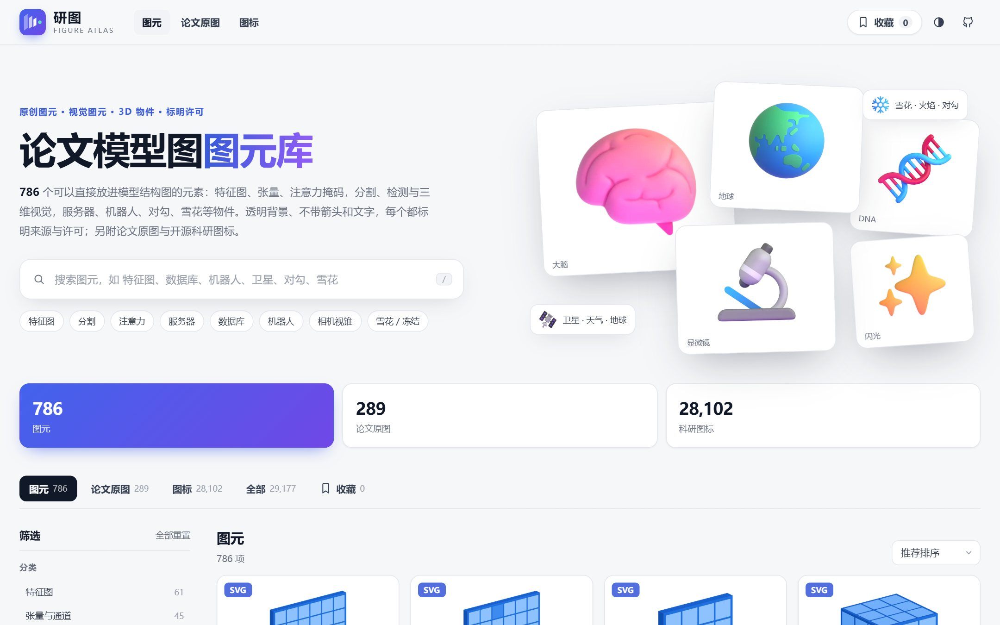
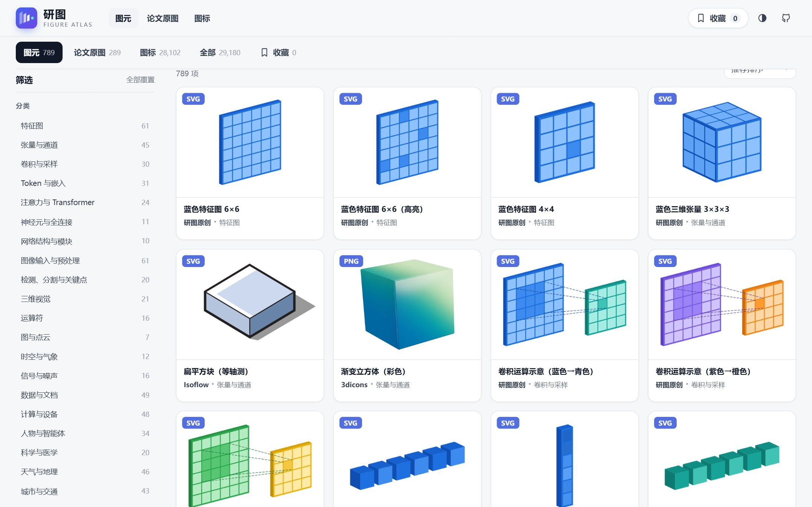
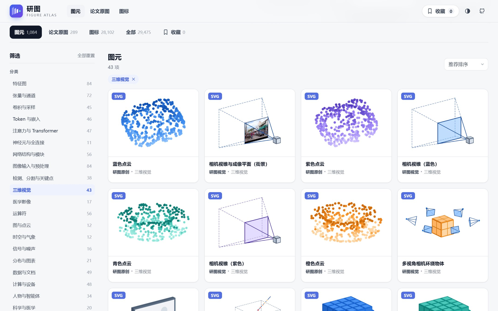
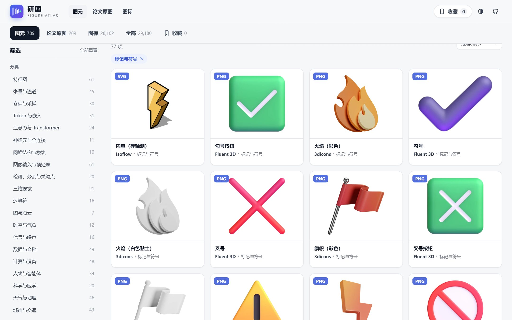
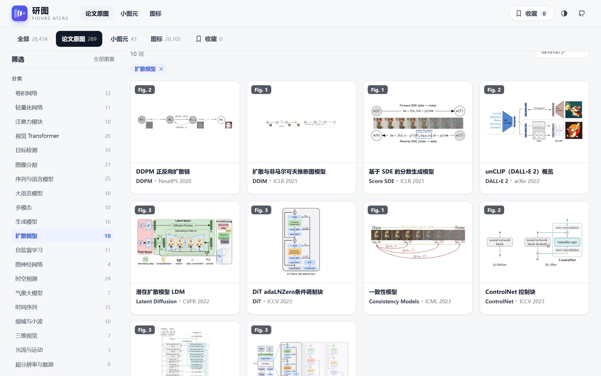
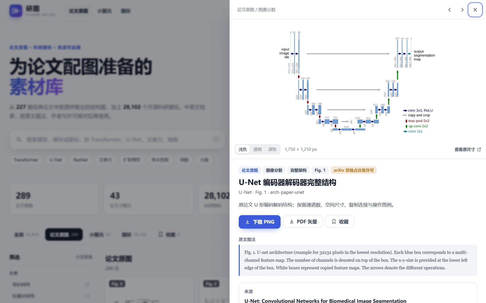
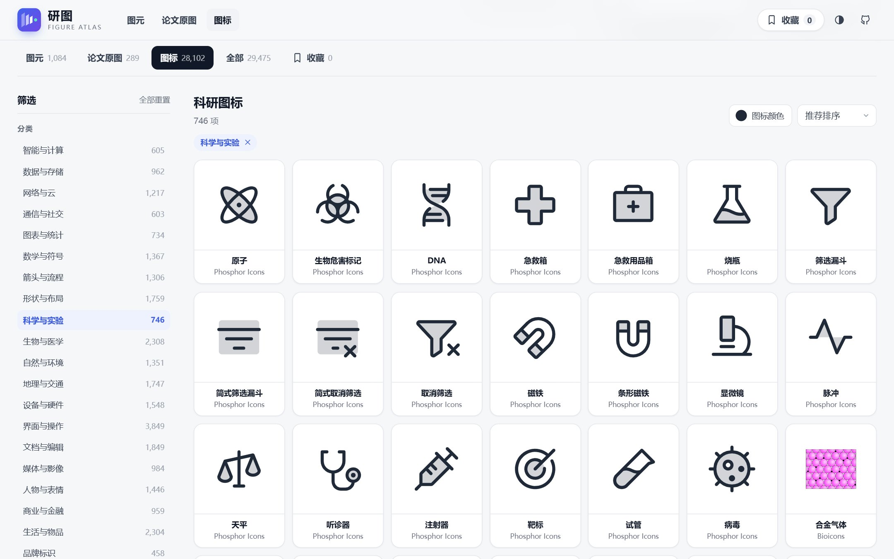

<p align="center"></p>

<h1 align="center">研图 · Figure Atlas</h1>

<p align="center">论文配图图元库</p>

画模型结构图要用的图元，共 1,084 个，分三部分：

- **465 个原创图元**：特征图、张量、卷积核、Token、注意力掩码、运算符、雷达回波，以及卷积层块、编码器 / 解码器、U-Net、FPN、Transformer 层、MoE 等网络模块，Swin 窗口、可变形采样、IoU / NMS / RoI Align 等视觉示意，激活函数曲线、分布与损失曲面……按同一套等轴测风格和 8 种配色画好，可编辑 SVG，**CC0 授权**，无需署名。
- **169 个计算机视觉图元**：用 CC0 / 公有领域照片做出的输入图像、ViT 分块与 Token、MAE 掩码、扩散加噪、去噪 / 低光 / 去雾 / 去雨等复原输入、MixUp / CutMix / Mosaic 等数据增强、仿 CNN 的真实特征图、分割掩码与抠图、检测框、SAM 提示与标注、人体关键点，CT / MRI / X 光 / 病理 / 荧光显微等医学影像；以及相机视锥、NeRF 射线采样、体素、网格模型、代价体、哈希网格、激光雷达、语义占据、物体点云、3D 高斯等三维视觉示意。全部 CC0。
- **450 个开源物件与装饰**：等轴测的服务器、数据库、文档、笔记本电脑，3D 的机器人、大脑、卫星、云朵、显微镜、汽车，以及对勾、火焰、雪花、序号、奖杯等标记，还有全连接网络、LeNet / AlexNet 式特征块等网络模块。全部是透明背景的单个元素，不带箭头和文字，可以直接放进模型图充当模块、补充细节或做点缀。来自 [Fluent Emoji 3D](https://github.com/microsoft/fluentui-emoji)、[3dicons](https://3dicons.co/)、[Isoflow](https://github.com/markmanx/isopacks)、[NN-SVG](https://github.com/alexlenail/NN-SVG)，保留原许可（MIT / CC0），详情页给出可直接复制的署名。

另附 289 张按原样裁剪的经典论文原图和 28,102 个开源科研图标。

[在线检索](https://runtimewarning.github.io/research-figure-library/) · [GitHub 仓库](https://github.com/RuntimeWarning/research-figure-library) · [完整来源清单](dist/sources.csv)



## 素材规模

| 集合 | 数量 | 说明 |
| --- | ---: | --- |
| **图元** | **1,084** | 原创 465（统一等轴测风格，CC0）+ 计算机视觉 169（CC0）+ 开源物件与装饰 450（保留原许可） |
| 论文原图 | 289 | 来自 216 篇论文（1997–2025），覆盖 21 个方向；按原样裁剪，不重绘、不改色 |
| 科研图标 | 28,102 | 10 个开源图标集，统一为 20 个中文分类，可按图标集筛选 |
| **合计** | **29,475** | 每项素材在 `dist/sources.csv` 中列出文件、来源、许可与 SHA-256 |

### 图元



原创图元、计算机视觉图元和收集的物件按内容统一分为 25 类，侧栏还可以按来源筛选：

| 分类 | 原创 | 收集 | 内容 |
| --- | ---: | ---: | --- |
| 特征图 | 84 | — | 6×6 / 4×4 / 3×3 特征图（普通与高亮）、热力特征图、响应图、下采样与上采样序列、Viridis / Magma / Plasma / Turbo / 冷暖配色特征图、掩码与稀疏特征图、由照片算出的真实感特征图堆叠与通道可视化、输入图像与逐级特征图 |
| 张量与通道 | 61 | 11 | 三维张量、扁平张量、多通道堆叠、RGB 三通道、通道拼接、8 色纯色张量块与薄层块、半透明张量、通道分组与重排、全局平均池化、展平、等轴测与 3D 立方体、球体、几何体 |
| 卷积与采样 | 45 | — | 卷积核、池化、空洞卷积、感受野、图像分块、上采样、深度可分离卷积、可变形卷积采样点、转置卷积、像素重排、步长与零填充、Sobel / 拉普拉斯 / 高斯核、条形可分离核、Patch Merging、双线性插值 |
| Token 与嵌入 | 46 | — | Token 序列、特征向量、嵌入矩阵、Q / K / V、码本、记忆队列、Token 剪枝与合并、带省略号的长序列、寄存器 Token、正弦位置编码、相对位置偏置、独热向量、隐向量 |
| 注意力与 Transformer | 47 | — | 因果、滑动窗口、稀疏等注意力掩码，注意力热图，相似度矩阵，Swin 窗口与移位窗口，可变形注意力（含多尺度），轴向、局部与全局注意力，多头注意力图，交叉注意力矩阵，CLIP 图文对比矩阵，通道（SE）与空间注意力 |
| 神经元与全连接 | 4 | 7 | 全连接网络（多种层数、按权重着色、竖向）、单个神经元 |
| 网络结构与模块 | 48 | 8 | 残差单元、卷积编码器 / 解码器层块、带全连接层的分类网络、U-Net、沙漏结构、梯形编码器与解码器、自编码器、孪生网络、教师—学生网络、Transformer 层、瓶颈块与倒残差块、Inception、MoE、密集连接块、FPN、LeNet 式特征图堆叠、AlexNet / VGG 式三维特征块 |
| 图像输入与预处理 | 84 | — | 输入照片、斜置图像平面、视频帧堆叠与时空块、图像金字塔、4×4 分块与展开、斜置的图像块 Token 与 MAE 掩码、扩散加噪、低分辨率 / 模糊 / 噪声 / 低光 / 雾天 / 雨天 / JPEG / 运动模糊 / 缺损输入与修复掩码、Canny 与 Sobel、RGB 通道、频谱、超像素、15 种数据增强（含 MixUp、CutMix、Mosaic、GridMask） |
| 检测、分割与关键点 | 38 | — | 分割掩码、分割叠加、透明抠图、单目标与多目标检测框、锚框、IoU、NMS、边框回归、RoI Align、中心点热力图、实例掩码堆叠、语义与实例标签图、YOLO 网格、SAM 点 / 框提示、多边形与涂鸦标注、类激活热力图、注意力热力图、人体关键点与骨架、关键点热力图、光流编码 |
| 三维视觉 | 43 | — | 相机视锥、多视角相机、相机轨迹、NeRF 射线采样、体素、八叉树、点云与三维检测框、汽车 / 椅子 / 飞机部件点云、街景语义点云、最远点采样与 K 近邻、激光雷达扫描、语义占据栅格、BEV 栅格、3D 高斯泼溅与高斯椭球、三平面、多分辨率哈希网格、代价体、SDF 切片、多平面图像、三角网格、坐标轴、双目三角测量、深度图 |
| 医学影像 | 17 | — | 胸部 X 光、脑部 CT 与 MRI、H&E 病理切片、荧光细胞核、肾组织共聚焦图像，CT 切片堆叠、斜置影像平面、荧光通道分离、细胞核实例分割与检测、脑组织三类分割、病理切片分块 |
| 运算符 | 56 | — | 加、减、乘、除、逐元素乘、拼接、求和、最大值、转置、Sigmoid、ReLU、Tanh、GELU、正弦、Softmax，常用运算符多种配色；ReLU / GELU / SiLU / ELU 等 10 种激活函数曲线 |
| 图与点云 | 12 | — | 图结构、邻居聚合、K 近邻图、二部图、超图、带节点特征的图、三角网格图、嵌入空间聚类 |
| 时空与气象 | 12 | — | 地球经纬网格、雷达回波图与序列、全球温度场、时空张量 |
| 信号与噪声 | 16 | — | 时间序列、高斯噪声、逐步加噪、频谱、小波子带 |
| 分布与图表 | 21 | — | 类别概率柱状图、直方图、高斯与高斯混合分布、域偏移、二维等高线、损失曲面与鞍点、损失 / 精度 / 学习率曲线、决策边界、超球面嵌入 |
| 数据与文档 | — | 49 | 数据库、文档、文件夹、书籍、图表、剪贴板、数据包、图像文件 |
| 计算与设备 | — | 48 | 服务器、容器、笔记本与台式电脑、手机、相机、路由器、信号塔、云、麦克风 |
| 人物与智能体 | — | 34 | 机器人、技术人员、科学家、医护人员、学生、用户、对话气泡、大脑、眼睛 |
| 科学与医学 | — | 20 | 显微镜、望远镜、试管、培养皿、DNA、微生物、药丸、心脏、肺、X 光片 |
| 天气与地理 | — | 46 | 地球仪、世界地图、云、雨、雪、雷电、龙卷风、气旋、温度计、山、火山、卫星 |
| 城市与交通 | — | 43 | 汽车、公交车、货车、飞机、船、火车、红绿灯、高速公路、楼房、工厂、医院 |
| 动物与植物 | — | 24 | 猫、狗、鸟、鱼、蜜蜂、树、幼苗、稻穗、向日葵 |
| 标记与符号 | — | 77 | 对勾、叉号、警告、问号、火焰（可训练）、雪花（冻结）、闪光、星星、序号 1–10、加减乘除、奖牌、奖杯、旗帜、图钉 |
| 通用物件 | — | 83 | 灯泡、齿轮、工具箱、放大镜、锁与钥匙、盾牌、拼图、沙漏、秒表、火箭、天平、魔杖 |

**原创图元**：单色元素提供 8 种配色（蓝、青、橙、紫、绿、珊瑚红、石墨灰、琥珀黄）。SVG 里每个面、每个格子都是独立图形，在 PowerPoint、Illustrator、Inkscape 或 draw.io 中可以直接改色、增删格子、改尺寸。全部由 [`pipeline/elements/generate.py`](pipeline/elements/generate.py) 用同一个正交相机和配色表生成（绘图工具见 [`style.py`](pipeline/elements/style.py)，网络模块、注意力与检测示意、图表见 [`blocks.py`](pipeline/elements/blocks.py)），新增元素也会保持一致的风格。

**计算机视觉图元**（169 个，CC0）：其中 128 个由 19 张 CC0 / 公有领域照片与医学图像（Wikimedia Commons 与 scikit-image 示例图）用 [`pipeline/elements/vision.py`](pipeline/elements/vision.py) 处理得到：分割用 GrabCut 生成，边缘用 Canny / Sobel，超像素用 SLIC，细胞核用阈值加分水岭分割，脑组织用 k-means 分类，特征图是 Gabor、高斯差分与颜色对立滤波器组的整流响应，各种退化按成像模型合成，检测框、人体关键点、提示点与涂鸦为人工标注；其余为同一等轴测风格的三维视觉示意，SVG 可编辑。详情页给出原始照片链接。



**收集的物件**：



| 来源 | 数量 | 许可 | 内容与格式 |
| --- | ---: | --- | --- |
| [Fluent Emoji 3D](https://github.com/microsoft/fluentui-emoji)（Microsoft） | 283 | MIT | 三维渲染的人物、设备、天气、交通、科学物件与标记，透明 PNG（256 px） |
| [3dicons](https://3dicons.co/)（Vijay Verma） | 118 | CC0 1.0 | 60 种三维物件，各有彩色与白色黏土两种风格，透明 PNG（400 px） |
| [Isoflow isopacks](https://github.com/markmanx/isopacks)（Mark Mankarious） | 34 | MIT | 等轴测服务器、数据库、文档、电脑、用户、齿轮、几何体等，可编辑 SVG |
| [NN-SVG](https://github.com/alexlenail/NN-SVG)（Alexander LeNail） | 15 | MIT | 不带标注的全连接网络、LeNet 式与 AlexNet / VGG 式结构，SVG |

只收录能单独放进图里的元素：不带箭头、文字标注，也不是针对某个具体任务画好的整张示意图。每个物件的详情页列出原始文件链接、许可和一段可直接复制的英文署名。

### 论文原图覆盖的方向



| 方向 | 代表模型 |
| --- | --- |
| 卷积网络与轻量化 | LeNet-5、AlexNet、VGG、GoogLeNet / Inception v3–v4、ResNet、ResNeXt、DenseNet、Xception、SENet、MobileNet v1–v3、ShuffleNet、EfficientNet、ConvNeXt、RepVGG、HRNet、GhostNet |
| 注意力模块 | CBAM、ECA、Coordinate Attention、Non-local、GCNet、SKNet、BAM、Triplet Attention、DANet、Attention Gate |
| 视觉 Transformer | ViT、Swin、DeiT、PVT、MLP-Mixer、CvT、MobileViT、PoolFormer、CoAtNet、MaxViT、Vision Mamba |
| 检测与分割 | R-CNN 系列、YOLO、SSD、RetinaNet、FPN、DETR、Deformable DETR、FCOS、RT-DETR、Grounding DINO、FCN、U-Net / UNet++ / 3D U-Net / V-Net、DeepLabv3+、PSPNet、SegFormer、Mask2Former、SAM / SAM 2、TransUNet、Swin-Unet、UNETR |
| 序列、语言与大模型 | Seq2Seq、Bahdanau 注意力、Transformer、BERT、GPT-3、T5、BART、XLNet、Transformer-XL、Longformer、MoE、Switch Transformer、LoRA、Adapter、Prefix-Tuning、InstructGPT、RAG、FlashAttention、Mamba、RWKV、RetNet |
| 生成与扩散 | GAN、cGAN、DCGAN、pix2pix、CycleGAN、StyleGAN 1–2、VAE、VQ-VAE、VQGAN、Glow、RealNVP、DDPM、DDIM、Score SDE、Latent Diffusion、ControlNet、DiT、unCLIP、Consistency Models |
| 自监督与多模态 | SimCLR、MoCo、BYOL、SimSiam、Barlow Twins、DINO、BEiT、MAE、CLIP、BLIP / BLIP-2、LLaVA、Flamingo、ViLT |
| 时空、气象与时间序列 | ConvLSTM、TrajGRU、PredRNN、PhyDNet、SimVP、Earthformer、DGMR、SmaAt-UNet、LDCast、PreDiff、CasCast、DiffCast、FourCastNet、Pangu-Weather、GraphCast、FengWu、FuXi、ClimaX、MetNet、Informer、Autoformer、FEDformer、PatchTST、TimesNet、iTransformer、DLinear、TCN、WaveNet、N-BEATS、TFT、DeepAR |
| 图、三维与其他 | GCN、GAT、GraphSAGE、Graphormer、DCRNN、STGCN、Graph WaveNet、PointNet / PointNet++、DGCNN、VoxelNet、NeRF、3D Gaussian Splatting、FNO、GFNet、WTConv、SRCNN、SRGAN、ESRGAN、Restormer、RAFT、PWC-Net、CapsNet、Neural ODE、STN、MAML |

### 图标集

| 图标集 | 数量 | 风格 | 许可 |
| --- | ---: | --- | --- |
| [Material Design Icons](https://pictogrammers.com/library/mdi/) | 7,188 | 实心，可改色 | Apache-2.0 |
| [Tabler Icons](https://tabler.io/icons) | 5,184 | 线性，可改色 | MIT |
| [Fluent System Icons](https://github.com/microsoft/fluentui-system-icons) | 3,095 | 线性 2,896 + 彩色 199 | MIT |
| [IconPark](https://github.com/bytedance/IconPark) | 2,654 | 多色 | Apache-2.0 |
| [Carbon Icons](https://carbondesignsystem.com/elements/icons/library/) | 2,505 | 实心，可改色 | Apache-2.0 |
| [Bioicons](https://bioicons.com) | 2,282 | 生物与实验插图 | CC0 / CC BY 3.0 / CC BY 4.0 / MIT（逐项，含作者） |
| [Fluent Emoji](https://github.com/microsoft/fluentui-emoji) | 1,587 | 彩色拟物 | MIT |
| [Carbon Pictograms](https://carbondesignsystem.com/elements/pictograms/library/) | 1,485 | 线描插画，可改色 | Apache-2.0 |
| [Phosphor Icons](https://phosphoricons.com) | 1,432 | 双色，可改色 | MIT |
| [Health Icons](https://healthicons.org) | 690 | 医疗实心，可改色 | MIT |

品牌标志、IBM 产品图标与国旗表情不收录；同一图标只收录一种字重。Fluent Emoji 的中文名称来自 Unicode CLDR，其余图标的中文名由 `pipeline/icons/zh_terms.tsv` 词表生成，英文原名始终保留，可直接用英文检索。

## 功能

- **一个搜索框**：搜索中文名、英文名、模型简称、作者、原文图注和标签；`U-Net`、`unet`、`UNet` 都能命中。按 `/` 聚焦搜索框。
- **分类与筛选**：图元 23 类并可按来源筛选，论文原图 21 个方向，图标 20 类；可只看完整架构图、附矢量文件的原图、可改色图标或科研常用图标。
- **论文原图详情**：原文图注、论文主页、直达原文 PDF 对应页、作者与许可；一键复制 BibTeX 或引用文本；下载 PNG，以及可用时的 SVG / PDF。
- **图标改色与导出**：单色图标可在网格中统一改色，详情页可选色后下载 SVG、复制 SVG 代码，或导出 256–2048 px 的透明 PNG。
- **收藏与分享**：收藏保存在当前浏览器；搜索条件写入网址，详情页可用 `#素材编号` 直接分享。
- **浅色 / 深色主题**，桌面与手机布局，全部为静态文件，无需后端或前端构建工具。





## 本地使用

只需要 Python 3.9 或更新版本，不依赖第三方包。

```bash
git clone https://github.com/RuntimeWarning/research-figure-library.git
cd research-figure-library
python scripts/serve.py
```

Windows 可直接双击根目录的 **`启动检索.cmd`**。浏览器打开 <http://127.0.0.1:8766/>，终端窗口关闭或按 `Ctrl+C` 后服务停止；端口被占用时运行 `python scripts/serve.py --port 8767`。请通过本地服务访问，直接双击 `dist/index.html` 会因浏览器的本地文件限制而无法加载索引。

## 论文原图是如何得到的

1. `pipeline/papers/fetch.py` 按 `papers.json` 中的 arXiv 编号下载固定版本的 PDF，并通过 arXiv API 与 OAI-PMH 记录标题、作者、版本和作者选择的许可。
2. `pipeline/papers/extract.py` 在 PDF 中定位图注（"Figure 3:"、"Table 1:" 等），自动排除正文、页眉页脚和图注本身，只取图形区域；个别排版特殊的图在 `figures.json` 中给出手工裁剪框。
3. 每张图导出 300 dpi PNG（以内嵌位图为主的图按原生分辨率渲染）、WebP 缩略图；矢量图在渲染逐像素比对一致时另存 SVG，紧凑时另存单页 PDF。
4. `pipeline/papers/catalog.py` 读取原文图注并合并元数据。每张原图都经过目检核对，确认没有带入正文、页眉或相邻的图。

裁剪只改变画幅，不重绘、不改色、不增删图中内容。早期由本项目手工绘制的 21 张架构示意图已全部删除，由对应论文的原图替代。

## 使用须知与许可

本项目自行编写的检索页面、构建脚本与数据整理采用 [MIT](LICENSE) 许可；**原创图元**（`dist/assets/elements/`）与**计算机视觉图元**（`dist/assets/vision/`，所用照片均为 CC0 或公有领域）采用 [CC0 1.0](https://creativecommons.org/publicdomain/zero/1.0/deed.zh-hans)，可自由使用、修改、商用，无需署名。第三方素材**不在**上述许可范围内：

- **收集的物件**（`dist/assets/collected/`）保留原许可：3dicons 为 CC0（无需署名），Fluent Emoji 3D、Isoflow 与 NN-SVG 为 MIT（保留版权声明）。详情页的「复制署名」给出可直接放进致谢的文字，许可原文在 [`dist/licenses/`](dist/licenses/)。

- **图标**保留各自的开源许可，许可原文在 [`dist/licenses/`](dist/licenses/)。Bioicons 中 CC BY 图标须按条目注明作者，作者与许可显示在详情页和 `sources.csv` 中。
- **论文原图**的版权属于原作者或出版方。每张图的许可按论文在 arXiv 上的选择记录：289 张中 229 张为 arXiv 非独占分发许可，35 张为 CC BY 4.0，另有 CC BY-SA、CC BY-NC-SA、CC BY-NC-ND、CC0 及出版方版权等，详情页会标出 NC（非商业）与 ND（禁止改编）等限制。本仓库收录这些原图用于学术检索与介绍；在论文、课件或出版物中使用时，请引用原论文，并按原许可或出版方规定取得授权。
- 如果你是论文作者或权利人，希望调整或移除某张图，请[提交 Issue](https://github.com/RuntimeWarning/research-figure-library/issues)，我们会尽快处理。

详见 [THIRD_PARTY_NOTICES.md](THIRD_PARTY_NOTICES.md)。

## 项目结构

```text
research-figure-library/
├── dist/                         # 发布到 GitHub Pages 的静态站点
│   ├── index.html · style.css · app.js · favicon.svg · og-image.jpg（分享卡片）
│   ├── data.json                 # 页面索引：论文原图记录 + 图标表
│   ├── sources.csv               # 每项素材的文件、来源、作者、许可与 SHA-256
│   ├── licenses/                 # 各图标集的许可原文
│   └── assets/
│       ├── elements/             # 原创图元 SVG / PNG 与 thumbs/ 缩略图
│       ├── vision/               # 计算机视觉图元 SVG / PNG / JPG 与 thumbs/ 缩略图
│       ├── collected/<来源>/      # 收集的物件 SVG / PNG 与 thumbs/ 缩略图
│       ├── papers/               # 论文原图 PNG / SVG / PDF 与 thumbs/ 缩略图
│       └── icons/<图标集>/        # 按图标集分目录的 SVG
├── pipeline/                     # 素材构建流程（需要 PyMuPDF 等，见 requirements.txt）
│   ├── papers/                   # 论文清单、下载、裁剪与元数据
│   ├── elements/                 # 原创图元：style.py 绘图工具，generate.py 元素清单与生成，blocks.py 网络模块与示意，vision.py 计算机视觉图元
│   ├── collected/                # 收集的物件：picks.py 选取清单，build.py 下载与处理，nnsvg.mjs 生成 NN-SVG 图
│   ├── icons/                    # 图标下载、清洗、分类、中文名词表
│   └── catalog.py                # 生成 dist/data.json 与 dist/sources.csv
├── scripts/
│   ├── serve.py                  # 本地检索服务（仅标准库）
│   └── validate.py               # 索引、文件、SVG 安全与哈希校验（仅标准库）
├── docs/                         # README 截图
└── .github/workflows/pages.yml   # 校验后部署 GitHub Pages
```

## 更新素材

```bash
pip install -r pipeline/requirements.txt
python pipeline/papers/fetch.py       # 下载论文 PDF 与元数据（缓存在 .cache/）
python pipeline/papers/extract.py     # 裁剪 figures.json 中的图，生成 .cache/papers/qa/ 核对图
python pipeline/papers/catalog.py     # 合并论文原图元数据
python pipeline/elements/generate.py  # 生成全部原创图元（SVG、PNG、缩略图）
python pipeline/elements/vision.py    # 下载 CC0 照片并生成计算机视觉图元（需要 opencv-python-headless、scikit-image、tifffile）
python pipeline/icons/fetch.py        # 下载固定版本的图标源包
python pipeline/icons/build.py        # 清洗、分类并写入 dist/assets/icons/
node pipeline/collected/nnsvg.mjs .cache/web/NN-SVG-<提交> .cache/web/nn-svg-out  # 需要 puppeteer-core 与 Chrome
python pipeline/collected/build.py    # 下载固定版本的 Fluent Emoji 3D、3dicons、Isoflow、NN-SVG 物件
python pipeline/catalog.py            # 生成 data.json 与 sources.csv
python pipeline/check_edges.py        # 检查图元是否贴边（贴边通常意味着被裁掉一部分）
python scripts/validate.py --hashes   # 校验
```

- **新增图元**：在 `generate.py` 的 `build_specs()` 中用 `add(...)` 登记，复用 `style.py` 的 `slab`、`cube`、`extrude`、`disc` 等绘图函数，再运行 `generate.py`。
- **收集更多物件**：在 `pipeline/collected/picks.py` 中加入条目（Fluent Emoji 按 CLDR 英文名、3dicons 按名称、Isoflow 按文件名），再运行 `build.py`；新来源需在 `SOURCES` 中写明许可、署名与固定提交，且只收录不带箭头和文字的单个元素。
- **新增论文图**：在 `pipeline/papers/papers.json` 加入 arXiv 编号，在 `figures.json` 加入图号、中文名、分类与说明，依次运行上面的论文步骤，并查看核对图确认裁剪无误。
- **改进图标中文名**：在 `pipeline/icons/zh_terms.tsv` 增加“英文词 / 中文”对照，可用第三列限定图标集，然后重新运行图标构建。
- 所有 SVG 在构建时去除脚本、事件属性、外部引用与编辑器元数据；`validate.py` 会再次检查。

推送到 `main` 后，GitHub Actions 会运行校验并把 `dist/` 部署到 GitHub Pages（仓库 **Settings → Pages → Source** 选择 **GitHub Actions**）。
