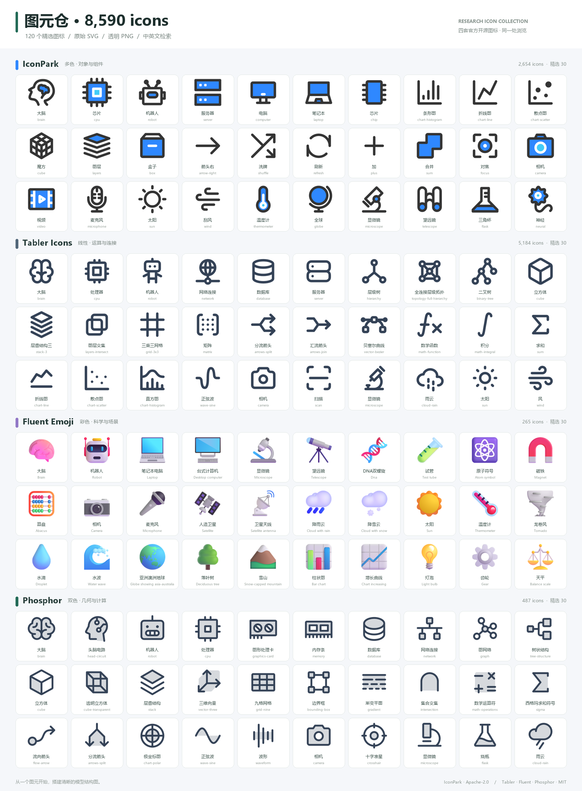
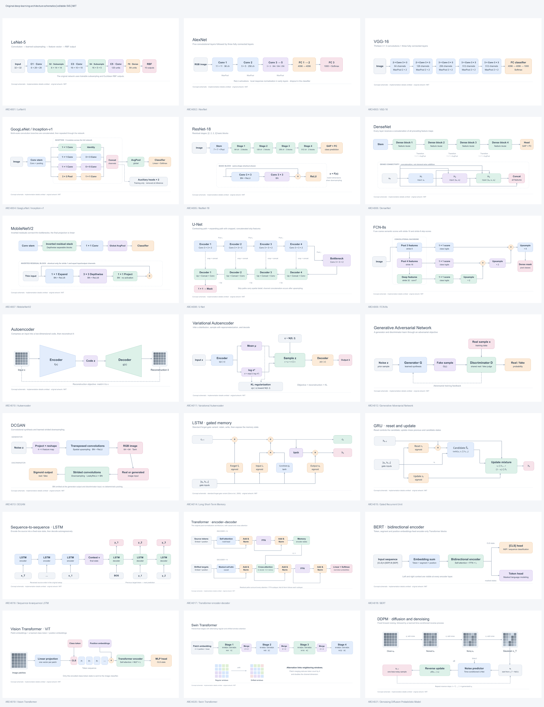

# 论文素材统一检索 · Research Figure Library

“图元仓”是为深度学习模型结构图整理的图标、经典架构与配图检索工具。一个页面搜索中文名称、英文名称、用途和来源，支持分类筛选、收藏、预览与单张下载。

[在线检索](https://runtimewarning.github.io/research-figure-library/) · [GitHub 仓库](https://github.com/RuntimeWarning/research-figure-library)



## 素材规模

| 系列 | 数量 | 内容 |
| --- | ---: | --- |
| IconPark 多色图标 | 2,654 | 计算、数据、箭头、几何形状、工具等 |
| Tabler 线性图标 | 5,184 | 网络拓扑、数学、图表、层叠、天气等 |
| Microsoft Fluent 彩色场景 | 265 | 大脑、机器人、设备、实验、天气和地理等 |
| Phosphor Duotone 精选 | 487 | 计算节点、张量层叠、几何网格、数学、流程、科学与天气 |
| 论文细节配图 | 53 | 注意力、频域、小波、特征、卷积和光流等 |
| 独立论文小图元 | 37 | 权重条、卷积核、采样网格、频谱曲面等 |
| 经典架构原论文图 | 19 | LeNet、AlexNet、ResNet、U-Net、Transformer、ViT 等 |
| 原创经典架构 SVG | 21 | 独立绘制、可编辑、透明背景，可随项目公开 |
| **合计** | **8,720** | 按独立素材计数，PNG/SVG 格式不重复计数 |

默认提供 **2,303 项论文常用素材**。图标保留 SVG；页面可导出 512 × 512 透明 PNG，Tabler 与 Phosphor 图标支持改色。原创架构图可导出保留图形比例、最长边 2,048 像素的透明 PNG。论文配图保留原 PNG、可用的 SVG 和裁剪 PDF；详情页标明混合图、内嵌位图 SVG 等格式差异。

## 本地使用

需要 Python 3.9 或更新版本，无需安装依赖。

```bash
git clone https://github.com/RuntimeWarning/research-figure-library.git
cd research-figure-library
python scripts/serve.py
```

Windows 双击根目录的 **`启动检索.cmd`**，或在项目目录运行：

```bash
python scripts/serve.py
```

浏览器打开 **[http://127.0.0.1:8766/](http://127.0.0.1:8766/)**。终端窗口关闭或按 `Ctrl+C` 后服务停止；下次运行相同命令即可恢复。端口被占用时可运行 `python scripts/serve.py --port 8767`。

请通过 HTTP 服务访问，直接双击 `index.html` 可能因浏览器对本地文件的限制而无法加载索引。本机网址不对外网开放。

## 检索与下载

- 搜索中文、英文或用途，例如 `卷积核`、`张量`、`网络`、`箭头`、`降雨`、`brain`、`cube`。
- 切换全部、论文常用、论文配图、小图元、图标或收藏，并按用途与风格进一步筛选。
- “经典架构”集中展示原论文结构图与原创概念示意；可按风格区分两者，搜索 `ResNet`、`U-Net`、`Transformer`、`ViT` 等名称。
- 点击卡片查看大图、背景效果、来源和许可，下载可用的 SVG、PNG 或 PDF。
- 收藏保存在当前浏览器的本地存储中。

## 经典架构

点击页面的 **“经典架构”**，可浏览 40 项内容：21 张原创可编辑概念图，以及 19 项从原论文提取的结构图或结构单元。



| 原创示意图系列 | 覆盖模型 |
| --- | --- |
| 卷积与轻量网络 | LeNet-5、AlexNet、VGG-16、GoogLeNet、ResNet-18、DenseNet、MobileNetV2 |
| 分割与编码解码 | U-Net、FCN-8s |
| 循环与序列 | LSTM、GRU、Seq2Seq LSTM |
| Transformer | Transformer、BERT、ViT、Swin |
| 潜变量与生成 | Autoencoder、VAE、GAN、DCGAN、DDPM |

原创架构图可随仓库公开，SVG 的文字、节点和箭头均可编辑；它们是根据原论文事实独立绘制的概念简图，不是论文原图，也不代替逐层实现。LSTM 示意图明确采用包含遗忘门的常用变体。原论文图继续保留在本地，通过相同入口检索；公开版本显示其来源卡片。

用 `python scripts/generate_architectures.py` 可重新生成原创 SVG，无需第三方依赖。可选的预览渲染使用 `resvg-py` 与 `Pillow`，见脚本的 `--qa` 参数。

## GitHub 开源与 Pages 部署

仓库已发布在 [RuntimeWarning/research-figure-library](https://github.com/RuntimeWarning/research-figure-library)。项目包含 GitHub Pages 工作流；无需 Node.js、npm 或第三方前端服务。自行部署到其他仓库时：

1. 在 GitHub 创建空仓库，将本项目提交并推送到 `main` 或 `master`。
2. 打开仓库 **Settings → Pages → Build and deployment → Source**，选择 **GitHub Actions**。
3. 在 **Actions** 运行 `Deploy GitHub Pages`，或再次推送触发部署。
4. 工作流完成后，打开部署结果中的网址。项目资源使用相对路径，兼容仓库子路径。

部署方式参考 [GitHub Pages 官方自定义工作流文档](https://docs.github.com/en/pages/getting-started-with-github-pages/using-custom-workflows-with-github-pages)。

本地项目的 `main` 分支已关联此仓库。提交后续更新可运行：

```bash
git add .
git commit -m "Update research figure library"
git push
```

公开构建也可以在本地生成：

```bash
python scripts/build.py --public --output _site
python -m http.server 8767 --directory _site --bind 127.0.0.1
```

**公开版本包含 8,590 个图标、21 张原创架构图和 109 项论文来源卡片。** 未核实再分发许可的论文图片保留在本地 `dist/assets/papers/`，由 `.gitignore` 排除；公开构建同时移除这些图片及其下载路径，避免出现失效图片。当前这份本地项目仍可完整检索全部 8,720 项素材。新克隆的公开仓库若没有本地论文图片，会显示论文来源卡片。

## 项目结构

```text
论文素材统一检索/
├── README.md
├── LICENSE                       # 本项目代码的 MIT 许可
├── THIRD_PARTY_NOTICES.md         # 第三方素材许可边界
├── 启动检索.cmd
├── scripts/
│   ├── serve.py                   # 本地完整检索服务
│   ├── build.py                   # GitHub Pages 公开构建
│   ├── validate.py                # 索引、文件、哈希与许可检查
│   └── generate_architectures.py  # 原创架构 SVG 的生成脚本
├── dist/
│   ├── index.html / app.js / style.css
│   ├── data.json                  # 合并后的唯一素材索引
│   ├── sources.csv                # 来源记录
│   ├── licenses/                  # 四套图标与原创架构图的许可证
│   └── assets/
│       ├── icons/                 # 8,590 个独立 SVG
│       ├── architectures/         # 21 张可编辑原创经典架构示意图
│       └── papers/                # 本地论文图片，不提交 Git
├── docs/preview.png
└── .github/workflows/pages.yml
```

`_site/` 是公开构建产物，不提交 Git。项目不需要压缩包，也不依赖原先的下载目录。

当前本地副本的 `.local-backup/` 保存整理前的下载目录与临时缓存，已排除 Git，不参与检索或公开构建；确认新项目正常使用后可自行删除。

更新素材后，可运行 `python scripts/validate.py` 检查索引、文件引用和许可记录；运行 `python scripts/validate.py _site` 检查公开构建。

## 来源与许可

本项目自行编写的检索界面与构建代码采用 [MIT](LICENSE)。第三方图标和论文配图不在本项目 MIT 许可的授权范围内。

| 素材来源 | 原许可 | 官方项目 |
| --- | --- | --- |
| IconPark | Apache-2.0 | [bytedance/IconPark](https://github.com/bytedance/IconPark) |
| Tabler Icons | MIT | [tabler/tabler-icons](https://github.com/tabler/tabler-icons) |
| Fluent Emoji | MIT | [microsoft/fluentui-emoji](https://github.com/microsoft/fluentui-emoji) |
| Phosphor Duotone | MIT | [phosphor-icons/core](https://github.com/phosphor-icons/core) |
| 论文配图 | 逐项查看原论文及权利说明 | 见 `dist/data.json` 与 `dist/sources.csv` |

四套图标的原始许可与版权声明保存在 `dist/licenses/`。本项目独立绘制的架构 SVG 使用 MIT 许可，原论文作为事实来源；这些概念简图省略部分实现细节，具体结构以原论文为准。论文原配图保留题名、链接、图号和处理说明；下载可访问性不代表已取得公开再分发许可，因此公开构建仅提供原论文图的来源索引。[arXiv 的复用说明](https://info.arxiv.org/help/license/reuse.html)

## 增补素材

新增记录应具有唯一 `id`、中文名称、标签、类别、来源 URL 和实际许可信息。把具有明确分发许可的图标 SVG 放入 `dist/assets/icons/`；论文本地图像放入 `dist/assets/papers/`；本项目原创架构图放入 `dist/assets/architectures/`，使用 `type: architecture`。经典架构原论文记录仍保留 `type: paper`，用 `architecture: true` 加入经典架构集合。同时更新 `dist/data.json` 与来源 CSV，并运行公开构建确认无断链。不要将未知许可自动标为 MIT，也不要用同一图标的多种导出格式增加素材计数。
